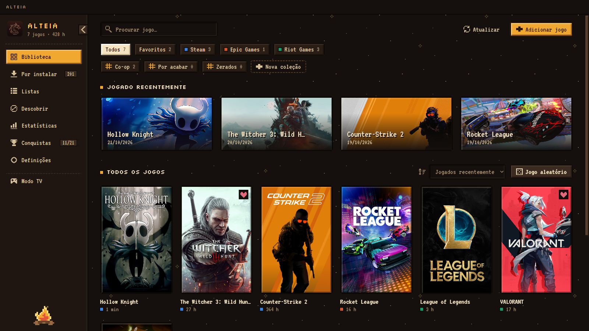
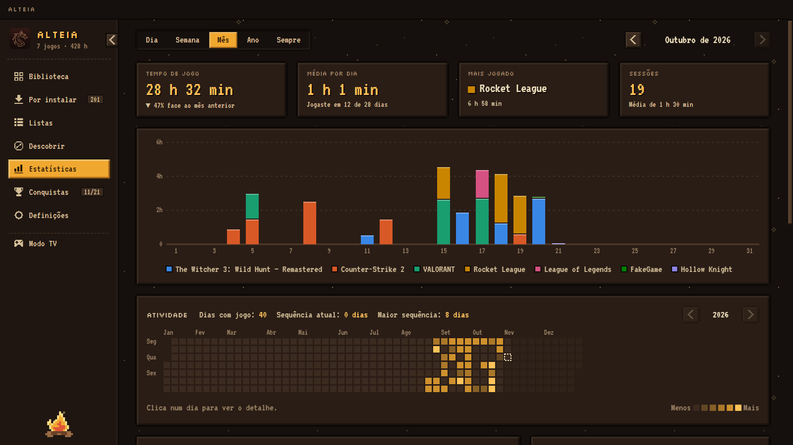
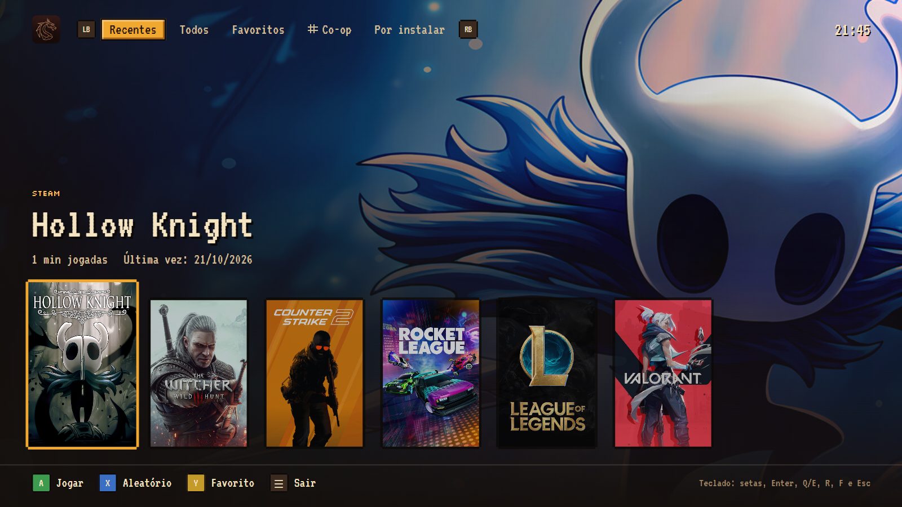
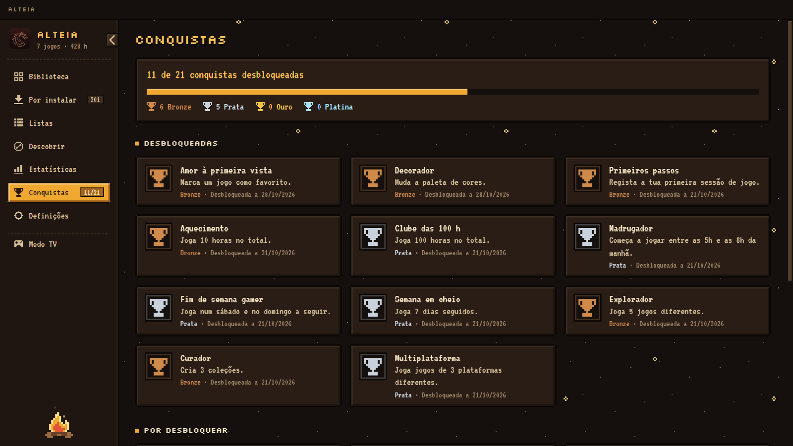
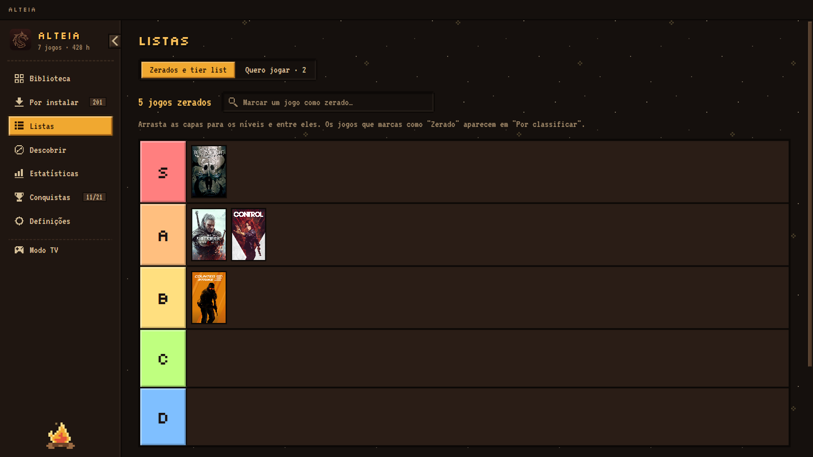

# ALTEIA

**Uma biblioteca cozy em pixel art para todos os jogos do teu PC.** A ALTEIA junta num só sítio os jogos da Steam, da Epic Games, da Riot e qualquer `.exe`, regista quanto tempo jogas e ajuda-te a decidir o que jogar a seguir.

*[English below](#english)*



## Funcionalidades

- **Deteção automática** dos jogos instalados na Steam, Epic Games e Riot Games, mais jogos `.exe` adicionados à mão. Os jogos novos aparecem sozinhos quando acabam de instalar.
- **Capas automáticas** (cache e CDN da Steam, SteamGridDB opcional), editáveis por jogo.
- **Registo de tempo de jogo**, mesmo que abras os jogos pela Steam, Epic ou Riot. A app pode ficar escondida na bandeja.
- **Estatísticas** por dia, semana, mês e ano, com uma cor por jogo e um calendário de atividade.
- **Por instalar:** os jogos das tuas contas Steam e Epic que não estão instalados, com instalação num clique.
- **Coleções**, estados (Por jogar, A jogar, Zerado, Desisti), **tier list** e lista **Quero jogar** com preços da loja Steam.
- **Descobrir:** recomendações a partir dos jogos em que passas mais tempo, e os jogos grátis da semana na Epic.
- **Conquistas** com pop-up e som, contadas só com o que jogas na ALTEIA.
- **Modo TV** em ecrã inteiro para jogar no sofá com o comando.
- **Cinco paletas** (Fogueira, Floresta, Lua, Sakura, Ameixa), cada uma com a sua cena animada.
- **Português (PT) e inglês.**

| Estatísticas | Modo TV |
|---|---|
|  |  |
| **Conquistas** | **Tier list** |
|  |  |

## Instalar

Descarrega o instalador `ALTEIA Setup x.y.z.exe` na página de [Releases](../../releases) e corre-o. O instalador não tem assinatura digital, por isso o Windows SmartScreen mostra um aviso: carrega em **Mais informações → Executar mesmo assim**.

Requisitos: Windows 10 ou 11.

## Desenvolvimento

Precisas do [Node.js](https://nodejs.org) 20 ou mais recente.

```bash
npm install
npm run dev
```

| Comando | O que faz |
|---|---|
| `npm run dev` | Abre a app em modo de desenvolvimento, com recarregamento automático da interface. |
| `npm start` | Compila a interface e abre a app. |
| `npm run dist` | Gera o instalador em `release/`. |
| `npm run release` | Gera o instalador e publica-o na pasta de atualizações local (`%USERPROFILE%\ALTEIA\updates`). A app instalada mostra "Nova versão" e atualiza-se com um clique. Antes, sobe a `version` no `package.json` e escreve as notas em `release-notes.txt`. |

### Como está organizado

| Parte | Ficheiro |
|---|---|
| Deteção de jogos (Steam, Epic, Riot) e pastas vigiadas | `electron/scanners.cjs` |
| Leitura dos ficheiros binários da Steam (licenças e apps) | `electron/steamBinary.cjs` |
| Capas e fundos | `electron/covers.cjs` |
| Registo de tempo (verifica os processos de 10 em 10 s) | `electron/tracker.cjs` |
| Conquistas | `electron/achievements.cjs` |
| Lojas e recomendações (Steam, SteamSpy, Epic) | `electron/discover.cjs` |
| Atualizações a partir de uma pasta local | `electron/updater.cjs`, `scripts/publish-local.cjs` |
| Janela, bandeja, pop-up e comunicação com a interface | `electron/main.cjs` |
| Interface (React) | `src/` |

Os dados de cada utilizador (jogos adicionados, sessões, capas, definições) ficam em `%APPDATA%\ALTEIA\` e nunca saem do PC.

## Aviso

A ALTEIA é um projeto pessoal e não é afiliada, aprovada nem patrocinada pela Valve, Epic Games, Riot Games ou SteamGridDB. Steam, Epic Games, Riot Games e os nomes e imagens dos jogos pertencem aos respetivos donos.

Para funcionar sem login, a app lê ficheiros locais que os launchers guardam no PC (por exemplo, a lista de jogos da conta Steam e o catálogo da Epic) e usa serviços públicos: a loja Steam, o [SteamSpy](https://steamspy.com) e a lista de jogos grátis da Epic. Estes ficheiros e serviços não são APIs oficiais e podem mudar sem aviso.

## Licença

[MIT](LICENSE) © 2026 Joao Pires

---

## English

**A cozy pixel-art library for every game on your PC.** ALTEIA brings Steam, Epic Games, Riot and any `.exe` game together in one place, tracks how long you play and helps you pick what to play next.

### Features

- **Automatic detection** of installed Steam, Epic Games and Riot Games titles, plus manually added `.exe` games. New games show up on their own once they finish installing.
- **Automatic covers** (Steam cache and CDN, optional SteamGridDB), editable per game.
- **Playtime tracking**, even when games are launched from Steam, Epic or Riot. The app can stay hidden in the tray.
- **Statistics** by day, week, month and year, with a color per game and an activity calendar.
- **Not installed:** games from your Steam and Epic accounts that aren't installed, with one-click install.
- **Collections**, statuses (Backlog, Playing, Completed, Dropped), a **tier list** and a **Want to play** list with Steam store prices.
- **Discover:** recommendations based on the games you play the most, plus the weekly free games on Epic.
- **Achievements** with a pop-up and sound, counted only from what you play with ALTEIA.
- **TV mode**, full screen, to play from the couch with a controller.
- **Five palettes** (Campfire, Forest, Moonlight, Sakura, Plum), each with its own animated scene.
- **Portuguese (PT) and English.**

### Install

Download `ALTEIA Setup x.y.z.exe` from [Releases](../../releases) and run it. The installer isn't code-signed, so Windows SmartScreen shows a warning: click **More info → Run anyway**.

Requires Windows 10 or 11.

### Development

You need [Node.js](https://nodejs.org) 20 or newer. Run `npm install`, then `npm run dev`. The commands and the code layout are described in the Portuguese section above.

### Disclaimer

ALTEIA is a personal project and is not affiliated with, endorsed or sponsored by Valve, Epic Games, Riot Games or SteamGridDB. Steam, Epic Games, Riot Games and game names and images belong to their respective owners. To work without logging in, the app reads local files the launchers keep on your PC and uses public services (the Steam store, [SteamSpy](https://steamspy.com) and Epic's free games list). These are not official APIs and may change without notice.

### License

[MIT](LICENSE) © 2026 Joao Pires
